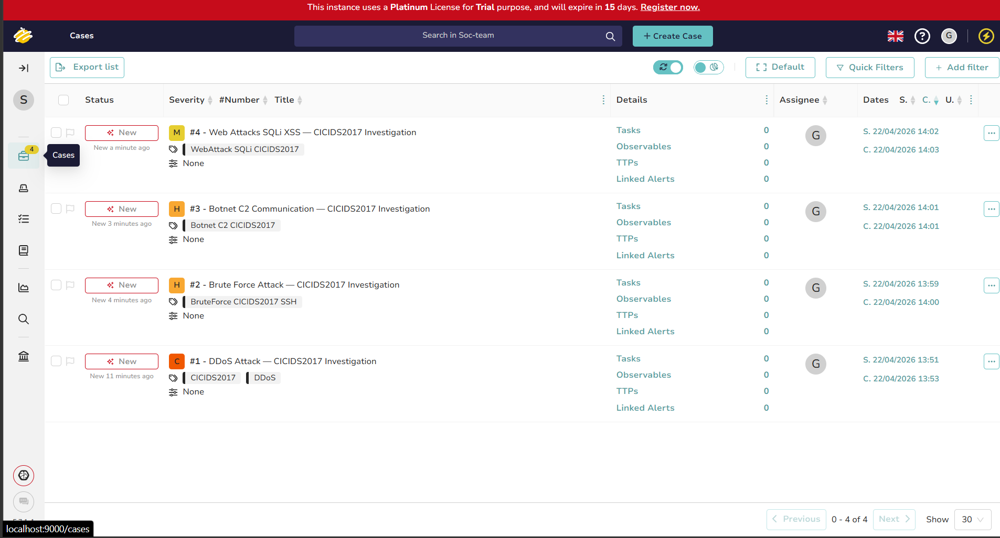
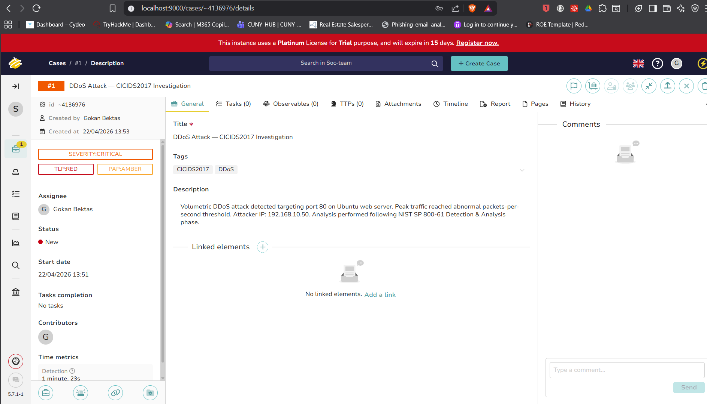
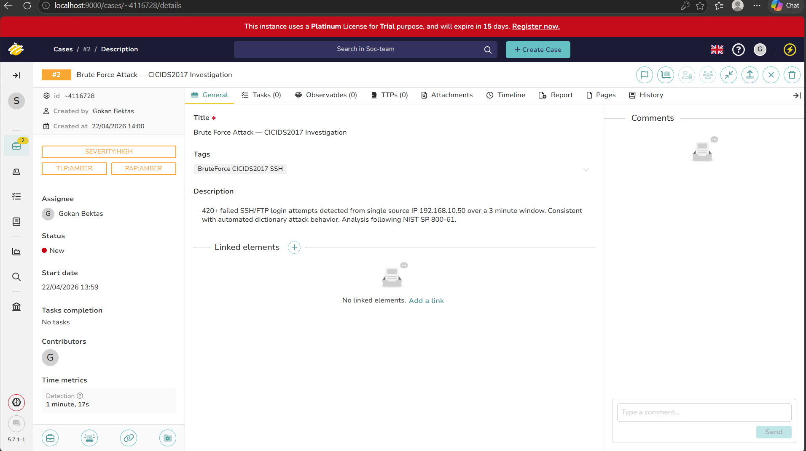
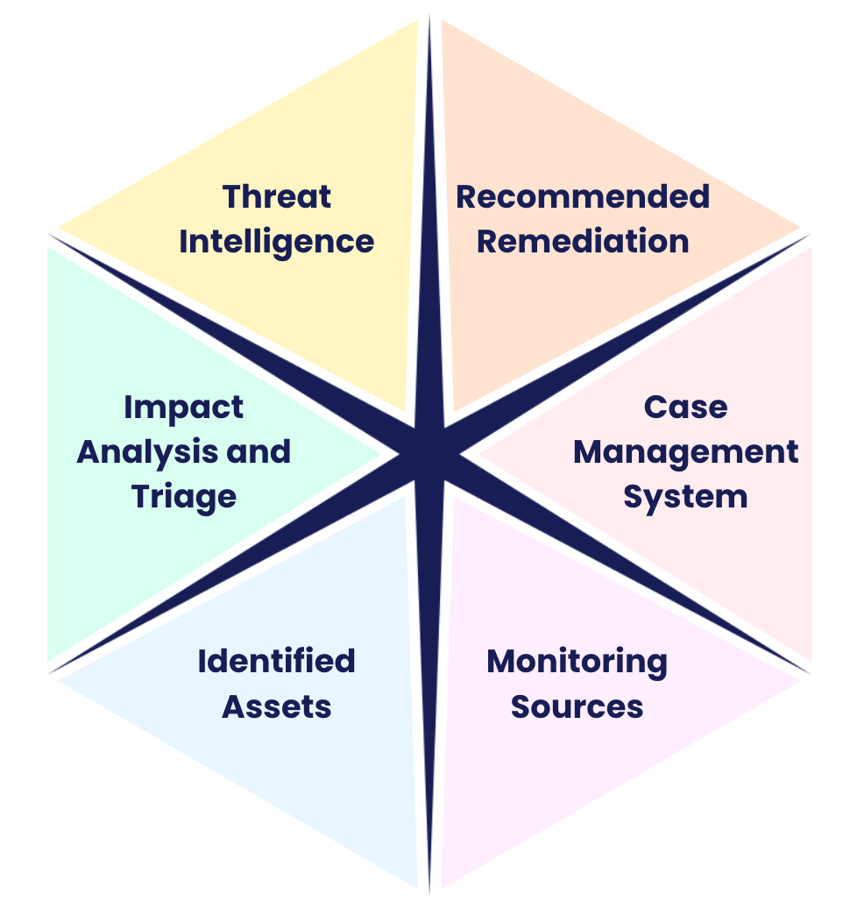

# Capstone — The Data Dig: CICIDS2017 SOC Investigation

**Course:** CodePath CYB102 · Weeks 9–10 · Group capstone (Group 14, team of 4)
**Tools:** TheHive · Splunk · Wireshark · VirusTotal · MITRE ATT&CK Navigator

> **My role:** I led the analysis — built the TheHive case-management environment, created and documented all four incident cases, did the MITRE ATT&CK mapping, and wrote the triage framework, remediation plan, and custom playbook. (Teammates' names kept private.)

## The project

A full SOC-style investigation of a real intrusion-detection dataset, following a professional incident-response playbook. The framing: *"The year is 2102, and your team is part of an elite unit of Techno-Archeologists"* analyzing a dataset from the 2020s — but the work underneath is exactly what a blue team does with a historical breach.

- **Dataset:** [CICIDS2017](https://www.unb.ca/cic/datasets/ids-2017.html) — the Canadian Institute for Cybersecurity's Intrusion Detection System Dataset. Realistic enterprise network (Windows/Ubuntu/macOS victims, Kali attacker at `192.168.10.50`), delivered as PCAP + CSV network flows.
- **Playbook:** [NIST SP 800-61 Rev. 2](https://nvlpubs.nist.gov/nistpubs/SpecialPublications/NIST.SP.800-61r2.pdf) — the gold-standard incident-handling framework, which we **adapted** from live-system response to forensic analysis of historical data.

## Hypotheses → findings

We made three educated guesses up front and then tested them against the data:

1. **DDoS** would show statistically significant packet/byte-rate anomalies vs. the benign baseline ✅
2. **Brute force** would show high-frequency failed auth from concentrated source IPs on ports 22/21 ✅
3. **Botnet C2** would show periodic beaconing — regular, timed outbound connections ✅

## What we found — four incidents

Each was logged as its own case in **TheHive**, with severity, TLP, evidence, analyst notes, and remediation:

| # | Incident | Severity | Key evidence | MITRE ATT&CK |
|---|----------|----------|--------------|--------------|
| 1 | **DDoS Attack** | 🔴 Critical | Volumetric flood on port 80 from `192.168.10.50`, abnormal packets/sec | T1498 |
| 2 | **Brute Force (SSH/FTP)** | 🟠 High | 420+ failed logins in a 3-minute window from one IP | T1110 |
| 3 | **Botnet / C2** | 🟠 High | Periodic beaconing to external IPs at regular intervals | T1071 |
| 4 | **Web Attacks (SQLi/XSS)** | 🟡 Medium | Injection attempts on Ubuntu web endpoints | T1190 |

## The six key aspects of the investigation

- **Monitoring Sources** — CICIDS2017 flow CSVs + raw PCAPs, treated as IDS/firewall/tap telemetry; Wireshark for packet inspection, Splunk as the SIEM.
- **Identified Assets** — mapped every victim machine, the web server, the gateway/firewall chokepoint, and the Kali attacker, the way a SOC documents blast radius.
- **Impact Analysis & Triage** — built a Critical/High/Medium/Low severity framework and prioritized DDoS + Botnet first.
- **Threat Intelligence** — mapped each attack to MITRE ATT&CK and the real threat groups that use those techniques (e.g. APT28 for brute force).
- **Recommended Remediation** — concrete per-attack fixes following NIST's Containment/Eradication/Recovery phase (rate limiting, MFA + SSH keys, endpoint isolation + C2 blocking, WAF + input validation).
- **Case Management** — all of it documented in TheHive, mirroring a real multi-incident SOC investigation.

## Stretch — custom playbook

We modified NIST SP 800-61 for forensic (not live) analysis: adapted the Detection and Containment phases for pre-captured data, **added a MITRE ATT&CK mapping step** (not in the original NIST playbook), added a TheHive documentation step, and added our custom triage-priority framework.

## Deliverables

- 4 fully documented incident cases in TheHive
- MITRE ATT&CK mapping of all attack types
- Triage/severity framework + per-attack remediation plan
- Custom adapted playbook + a one-page project summary
- 8-minute Demo Day presentation

## Skills

End-to-end SOC investigation · NIST SP 800-61 incident response · TheHive case management · MITRE ATT&CK mapping · intrusion-detection dataset analysis (CICIDS2017) · triage & severity frameworks · remediation planning · team leadership · technical communication
