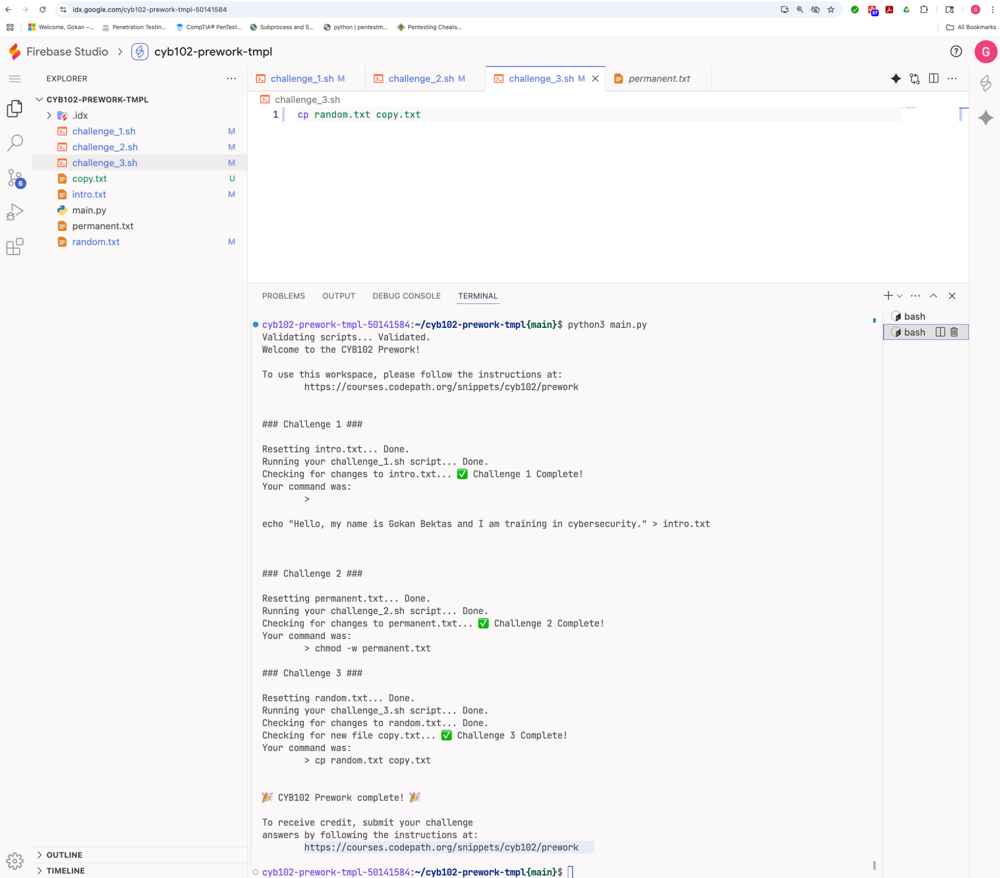

# Prework — Bash Scripting & Blue-Team Fundamentals

**Course:** CodePath CYB102 · Admission prework · **Tools:** Bash, Linux

## Overview

The prework that earned my place in the intermediate course. Two parts: hands-on Bash scripting challenges, and a set of blue-team scenario questions to start thinking like a defender.

## Part 1 — Bash challenges

Completed three terminal challenges in a Linux environment — redirecting command output to files, changing file permissions with `chmod`, and copying files — and passed all three validation checks.

## Part 2 — Thinking like a blue teamer

Answered scenario questions on defensive security concepts — approaching computing from the perspective of the team that *protects* systems rather than attacks them. This mindset (detect, monitor, respond) carried through the entire course.

## Skills

Bash scripting · Linux command line (`chmod`, redirection, file ops) · blue-team fundamentals
