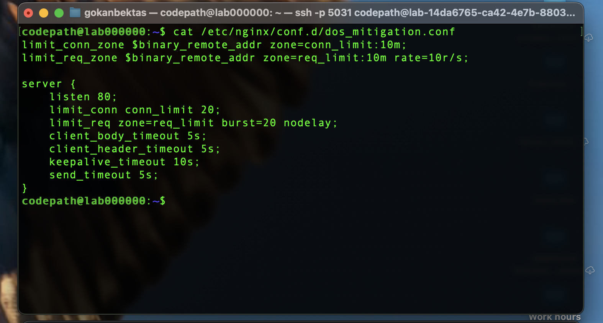
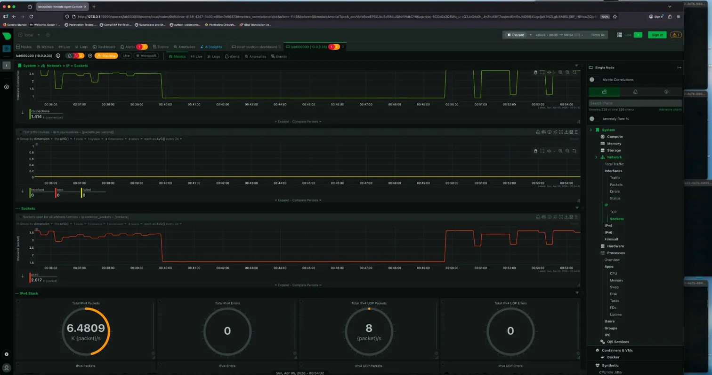
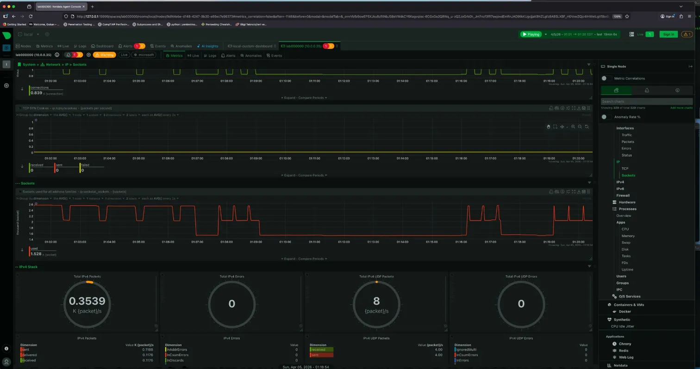

# Project 4 — DoS Mitigation with nginx

**Course:** CodePath CYB102 · Week 5 · **Tools:** nginx, Slowloris, Netdata, Wireshark

## The scenario

Run a **Slowloris** denial-of-service attack against a web server, then design nginx rules to defeat it. Slowloris is sneaky — instead of flooding the server with volume, it holds hundreds of connections open by sending partial HTTP headers *slowly*, exhausting the connection pool without the traffic spike that normal DoS defenses look for.

## What I did

1. Ran Slowloris against an **unprotected** nginx server and watched the connection count in Netdata.
2. Wrote nginx mitigation rules — `client_header_timeout`, `limit_conn`, `limit_req` — to force the server to drop connections that don't finish their headers in time.
3. Re-ran the attack against the **protected** server and compared the Netdata graphs.
4. **Stretch:** analyzed two `.pcap` files and proved which came from the vulnerable server vs. the protected one, using packet flags.

## What I found

**The connection graphs tell the whole story:**

| | Unprotected | Protected |
|---|---|---|
| Open connections | climbed to **2,500+** and stayed flat and high | sharp **dips and spikes** — nginx constantly dropping slow connections |
| Result | connection pool exhausted, server overwhelmed | server stayed functional |

**Packet-level proof (stretch):** the protected server's capture had **3,000 SYN and exactly 3,000 RST** packets — nginx killing every slow connection at the `client_header_timeout`. The vulnerable server's capture had **1,000 SYN but zero RST and zero FIN** — it just accepted and held every connection until it died. *A protected server sends RST to kill slow connections; a vulnerable one sends nothing.*

## Why it matters

Application-layer DoS needs different defenses than volumetric floods — you defend with **timeouts and per-client connection limits**, not just bandwidth. And you can confirm your mitigation worked by reading the packets.

## Skills

nginx hardening (`limit_conn`, `limit_req`, timeouts) · Slowloris / application-layer DoS · Netdata monitoring · Wireshark packet analysis (SYN/RST/FIN)
