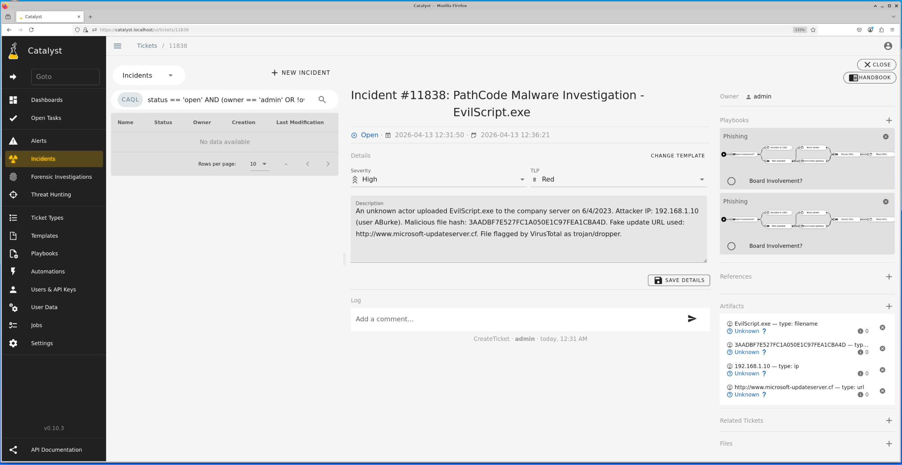
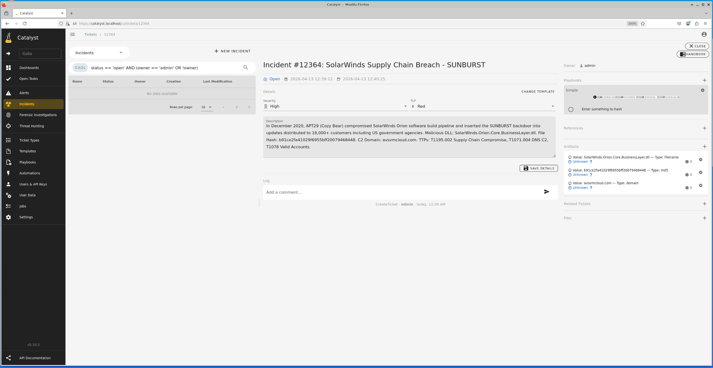

# Project 6 — Incident Response with Catalyst

**Course:** CodePath CYB102 · Week 7 · **Tools:** Catalyst, VirusTotal, MITRE ATT&CK, NIST SP 800-61

## The scenario

When an incident happens, someone has to run it to ground: triage it, research the indicators, document it, and write it up so the next analyst can act. **Catalyst** is an open-source incident-response platform built for exactly that. I documented a malware incident end-to-end, then wrote a framework analysis of a real-world breach.

## Part 1 — Documenting the malware case

Built out the `EvilScript.exe` case in Catalyst and researched every indicator on VirusTotal:

| Artifact | Finding (VirusTotal) |
|----------|---------------------|
| `EvilScript.exe` (MD5 `3AADBF7E...CBA4D`) | Flagged malicious; uploaded from `192.168.1.10` (user ABurke) |
| `http://www.microsoft-updateserver.cf` | **14/95 vendors** flagged it — fake Microsoft update / phishing domain |
| IP `192.168.1.10` | Tagged suspicious; 10+ files communicating with it |

**Lessons learned:** logging caught the full timeline, but the `.exe` uploaded *before* detection and the repeated failed logins should have alerted. Fixes I recommended: block `.exe` uploads, alert on brute-force login patterns, block suspicious domains at the proxy, enforce MFA.

## Part 2 — NIST framework analysis of the SolarWinds / SUNBURST breach

Wrote a full report mapping the 2020 **SolarWinds supply-chain attack** (APT29 / Cozy Bear) to the NIST incident-response lifecycle, and documented it as a Catalyst case with IOCs and MITRE ATT&CK TTPs:

- **IOCs:** `SolarWinds.Orion.Core.BusinessLayer.dll`, C2 domain `avsvmcloud[.]com`, SUNBURST backdoor, trojanized Orion update
- **TTPs:** T1195.002 (Supply Chain Compromise), T1543.003 (System Process), T1071.004 (DNS C2), T1078 (Valid Accounts), T1041 (Exfil over C2)
- **Analysis:** walked all five NIST phases (Identify → Protect → Detect → Respond → Recover) and what at each phase could have caught or contained it — e.g. DNS-beaconing anomaly detection on the dormant 14-day SUNBURST activation.

## Skills

Incident response (NIST SP 800-61 lifecycle) · case management in Catalyst · IOC research on VirusTotal · MITRE ATT&CK mapping · supply-chain breach analysis · lessons-learned reporting
