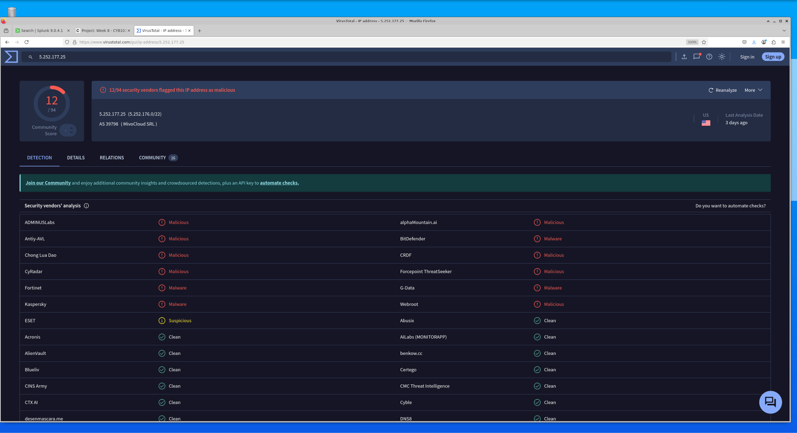
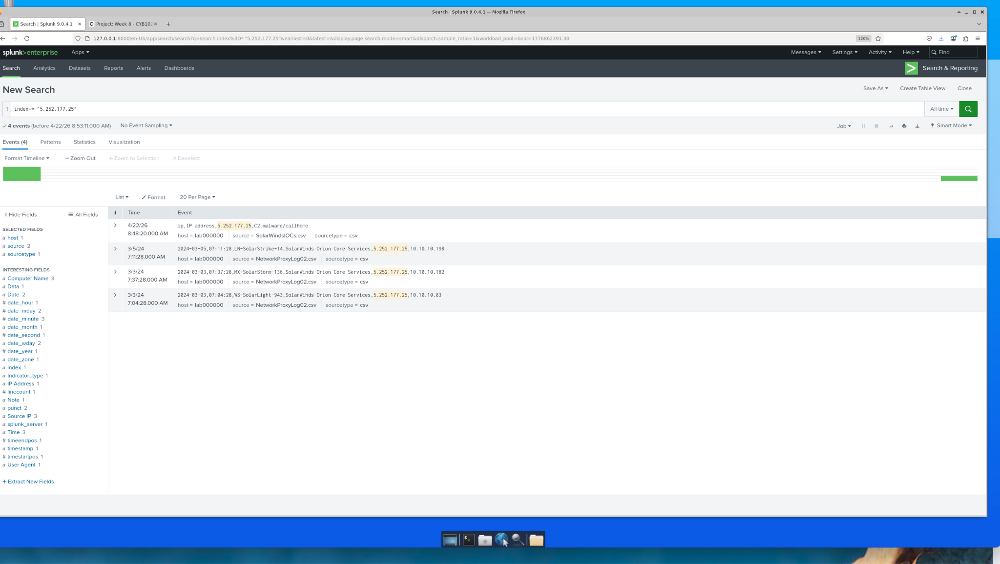
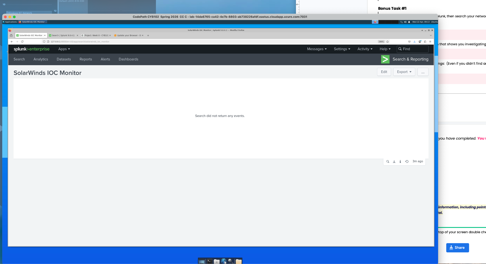
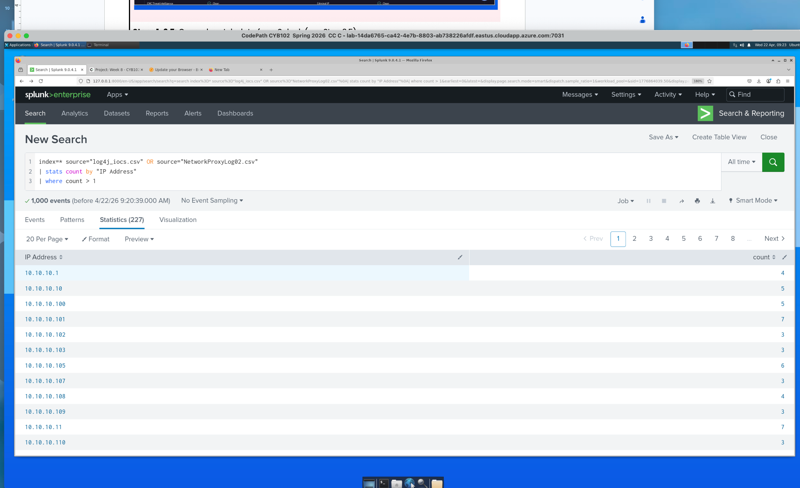

# Project 7 — Real-World Threat Hunting

**Course:** CodePath CYB102 · Week 8 · **Tools:** Splunk, VirusTotal, threat-intel feeds

## The scenario

Most SOC work is reactive — an alert fires, you investigate. **Threat hunting** flips that: you proactively search for signs of compromise using threat intelligence, *before* any alert triggers. This matters because sophisticated attackers can sit inside a network for weeks. I acted as a SOC analyst at "PathCode Inc." hunting for two real-world attack patterns in the company's proxy logs.

## What I did

Ingested a threat-intelligence feed into Splunk, wrote correlation searches to match our network logs against known-bad indicators, and confirmed each hit on VirusTotal.

**Correlation search:**
```spl
index=* | search "SolarWinds Orion Core Services"
| table Date, Time, "Computer Name", "IP Address", "Source IP"
```

## What I found — SolarWinds Orion C2 beacons

Machines on the network were beaconing out using the SolarWinds Orion user agent — the SUNBURST signature. Confirmed matches:

| Matched IP | Affected host(s) | VirusTotal |
|-----------|------------------|-----------|
| `5.252.177.25` | WS-SolarLight-943, MX-SolarStorm-136, LN-SolarStrike-14 | 12/94 malicious |
| `13.59.205.66` | WS-SolarWave-212 | 10/94 malicious |
| `54.215.192.52` | LN-SolarShadow-552 | 9/94 malicious |

Built a **"SolarWinds IOC Monitor" dashboard** in Splunk to track matches on an ongoing basis.





## Bonus — Log4Shell hunt

Imported the **Log4Shell** IOC list from the [NCSC-NL GitHub repo](https://github.com/NCSC-NL/log4shell) and searched the proxy logs. Result: 1,000 events / 227 unique IPs, but **all internal (10.10.10.x)** — meaning **no external Log4Shell matches**; none of our hosts talked to a known exploit server in that window. (Documenting a clean result, and *why* it's clean, is part of the job.)



## On stale IOCs

> If an IP was reported malicious a year ago, is it still dangerous? Yes and no — the IP may have been reassigned, but the fact that it beaconed using the SolarWinds Orion user agent is still worth documenting. **Context matters more than the IP's current reputation.**

## Skills

Proactive threat hunting · Splunk correlation searches · threat-intel feed ingestion · IOC confirmation on VirusTotal · dashboard building · documenting negative results
